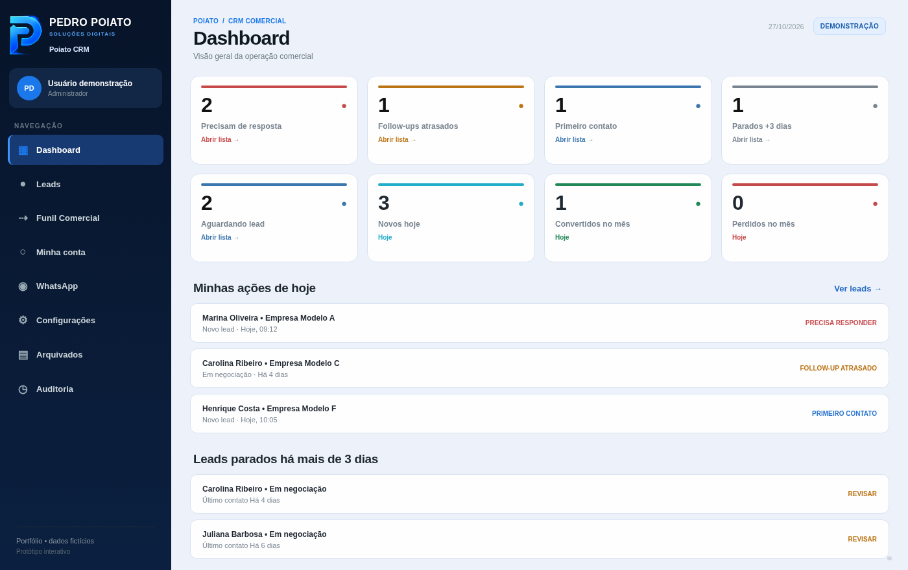

# Poiato CRM — demonstração interativa V2

Uma versão pública e independente de um CRM desktop em que trabalhei, recriada para o navegador com dados inventados. O projeto original é feito com **Python, CustomTkinter e MySQL**; esta demonstração usa **HTML, CSS e JavaScript**.

## Explore a demonstração

- Dashboard com follow-ups, tarefas e indicadores.
- Leads com busca, filtros, cadastro, edição e responsáveis.
- Funil Kanban com movimentação entre etapas.
- Ficha detalhada: contato, anotações, próxima atividade e histórico.
- Arquivamento e restauração de leads.
- Auditoria de movimentações durante a sessão.
- Configurações ilustrativas de perfil e distribuição por DDD.
- Exportação CSV e importação de até dez registros fictícios.

**[Abrir a demonstração no GitHub Pages](https://pedro-poiato.github.io/poiato-crm-demo/)** (depois de ativar o Pages).

## Limitações

Não existe servidor, banco de dados, autenticação, conexão com WhatsApp ou persistência após recarregar a página. Perfis e regras são ilustrativos. Não use dados reais: as informações que aparecem são fictícias. O código da aplicação empresarial original não está publicado.

Para testar no computador, abra `index.html` em um navegador.

Pedro Poiato — Soluções Digitais
